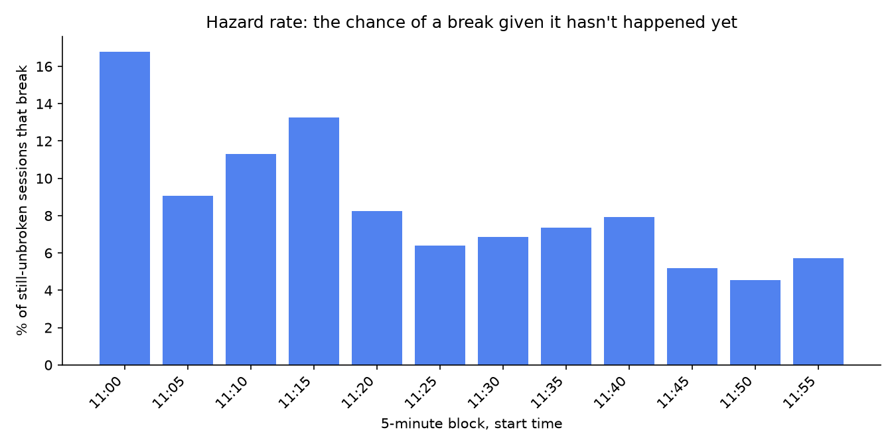
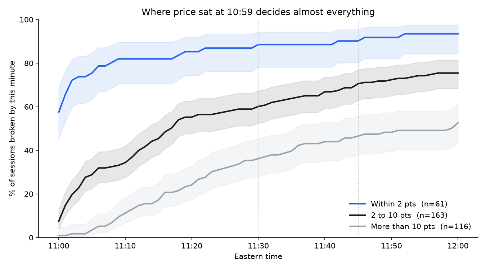
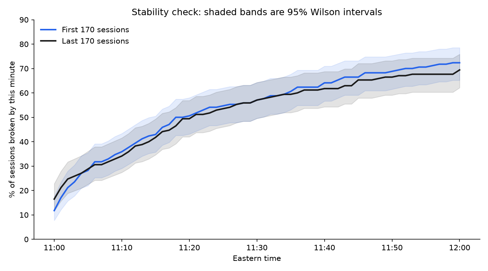

# Time to a New Session Extreme

How often does ES make a new session extreme between 11:00 and 12:00 Eastern, relative to the extreme set between 09:30 and 10:59? And when it happens, when does it happen?

```
Time to a New Session Extreme
│
├── Result ........................ 71% of 340 sessions, three cutoffs
│   ├── When it happens ........... break rate decays through the hour  [fig 2]
│   └── Where price is standing ... distance bands at 10:59             [fig 4]
│
├── The result I don't trust ...... direction looks predictive, distance explains it
│
├── Method ........................ survival analysis, two-window event study
│   ├── Pre-registration .......... two predictions: one passed, one inconclusive
│   ├── Stability ................. first 170 sessions vs last 170       [fig 3]
│   └── Validation ................ 10 random sessions checked by hand
│
├── Limitations ................... what 340 sessions cannot answer
├── What's next ................... longer sample, 11:30 windows, extension
├── Running it .................... setup and module order
├── Contents ...................... what each directory holds
└── Disclosure
```

## Result



Across 340 regular-hours sessions, 241 made a new extreme before 12:00. That's 70.9%, with a 95% Wilson interval of 65.8 to 75.5.

| Cutoff | Sessions | Rate | 95% CI |
|---|---|---|---|
| 11:30 | 194 | 57.1% | 51.7–62.2 |
| 11:45 | 224 | 65.9% | 60.7–70.7 |
| 12:00 | 241 | 70.9% | 65.8–75.5 |

Of the 241 breaks, 187 went in the same direction as the prevailing move and 54 against it.

### When it happens

Each bar covers five minutes. Its height is the share of sessions that broke during that block, counted only among sessions that were still unbroken when the block started. That denominator is the whole point: by 11:40 most sessions have already broken and left the pool, so a bar height of 5% means 5% of what remained, not 5% of 340.

The shape is a decay, from 16.8% in the first block to around 5% at the end. Read plainly: the longer a session goes without making a new extreme, the less likely it becomes that it will make one before 12:00. Waiting does not improve the odds. That is the opposite of how a pending move usually feels, and it is the single most useful thing in this repository.

The median break lands 11 minutes past 11:00, with a quartile range of 1 to 24 minutes. Half the action is over in the first eleven minutes of the window.

**What to do with it.** Pick your cutoff before the window opens, and make it
short. "If it hasn't gone by 11:15 I stop watching for it." Then log the times
you ignore your own rule, because those are the trades worth looking at later.

### Where price is standing when the window opens



Five rows, one per distance band. The dot is the measured break rate for that band. The line is its 95% confidence interval: the range of underlying rates that could plausibly have produced what was observed. The numbers on the right are the rate, the number of sessions in the band, and the median minutes to break among the ones that broke.

To use it: at 10:59, measure the distance from the close to whichever reference extreme is nearer. That number puts you in a row, and the row gives a probability with its uncertainty attached.

Two cautions on reading it. Where two lines overlap, the bands are not distinguishable with this much data — the top two rows are an example, and no claim should be made that one is better than the other. And where a line is long, the estimate is weak; line length is driven by how many sessions are in the band.

| Distance (from nearest extreme) at 10:59 | Sessions (n) | Break rate by 12:00 | 95% CI | Median minutes to break |
|---|---|---|---|---|
| ≤ 1 pt | 34 | 94.1% | 80.9–98.4 | 0 |
| 1–2 pts | 27 | 92.6% | 76.6–97.9 | 2 |
| 2–5 pts | 78 | 79.5% | 69.2–87.0 | 4.5 |
| 5–10 pts | 85 | 71.8% | 61.4–80.2 | 16 |
| > 10 pts | 116 | 52.6% | 43.6–61.4 | 21 |

Monotonic across all five bands: every step further away lowers the rate and raises the time.

The top two rows are close to arithmetic rather than a finding - ignore the top two rows. Within a point of the level, three quarters of sessions break inside the 11:00 bar itself — which is what a level already sitting inside the next bar's range will do. The informative part is the bottom three rows, where the rate falls from 80% to 53% as the median break time climbs from 4.5 minutes to 21.

**What to do with it.** At 10:59, measure the distance to the nearer level.
Beyond ten points you're in something close to a coin flip. Two to five points
is a four-in-five that usually resolves within a few minutes. Those deserve
different size, different patience, and different willingness to be wrong, and
most of us treat them identically because they look the same on the chart.

## The result I don't trust at face value

77.6% of breaks went with the prevailing direction, which looks like direction predicts breaks. This data cannot show that.

The with-trend extreme was the nearer one in 79.1% of sessions. That is almost exactly the 77.6% figure, and it has a simpler explanation: breaks go with trend because the with-trend level is closer, not because direction carries information. The two explanations produce the same number, and nothing in the number separates them.

Separating them needs a comparison within narrow distance bands, where with-trend and counter-trend levels sit the same distance away. At 340 sessions there are 26 such matched pairs within 3 points, which is not enough to conclude anything. That is the first item in the next phase.

The uncomfortable part: the result agreed with what I already thought, which is
exactly why I almost didn't check it. I only found this because I had decided
in advance to record distance, before I knew what the direction split would be.

## Method

Each session either breaks at a known minute or reaches 12:00 without breaking. That structure is a discrete-time survival analysis: the 99 non-breaking sessions are right-censored and stay in every denominator, the cumulative curve is a cumulative incidence function, and the five-minute chart is a discrete-time hazard rate. The two-window design — 09:30–10:59 to establish a reference, 11:00–12:00 to measure against it — is the standard event-study structure from empirical finance.

### Pre-registration

Thresholds and predicted rates were written to `notes/prediction.md` and committed before any statistics ran, so the commit timestamp is verifiable. Of the two pre-registered predictions, one passed and one was inconclusive.

At least 80% of sessions within 2 points would break: **passed**, lower bound 84.3%.

At least 50% beyond 10 points: **inconclusive**. Point estimate 52.6%, but the interval runs 43.6 to 61.4 and straddles the floor, so the test cannot resolve it at this sample size.

### Stability



Two estimates of the same quantity, computed on the first half of the sample and the second half, each with its interval. The question is whether the headline number describes the market or just describes the particular sixteen months it was measured in. First 170 sessions: 72.4% (65.2–78.5). Last 170: 69.4% (62.1–75.8).

The intervals overlap heavily, so I am treating this as one regime rather than two. Worth stating precisely: overlapping intervals are an absence of evidence for a split, not evidence that no split exists. With 170 sessions a side, only a large shift would show up here.

### Validation

Ten sessions were drawn at random with a fixed seed and checked by eye against the charting platform: reference high and its minute, reference low and its minute, and the minute of the first break. All ten agreed with the code. The record is in `output/hand_validation.md`.

## Limitations

This study measures whether a level gets taken out. It says nothing about
whether a trade on that works. A break that runs twenty points and one that
prints a tick through and reverses count identically here. Extension, duration,
and failure are not measured, so there is no target and no R-factor anywhere in
this.

The sample is 340 sessions over about sixteen months. That is enough for the headline rate and for the with-trend and counter-trend split. It is not enough for anything stratified two ways at once, and not enough to resolve whether direction matters independently of distance.

Distance is measured in index points, which conflates a close level on a wide-range day with a far level on a narrow one. A range-normalized version is planned.

Breaks use `>=` and `<=`, so trading exactly at the prior extreme counts as a break. That was chosen before results were examined, and the strict-inequality variant was not tested.

Only the first break in each session is recorded. A session that breaks the high at 11:04 and the low at 11:40 appears once.

## What's next

**1. A longer sample.** Sixteen months is 340 sessions, and nearly every follow-up
question dies on sample size. The matched comparison that would separate
direction from distance has twenty-six sessions in it. Three to five years makes
those cells workable.

**2. The windows moved to 11:30, with controls.** Reference range 09:30 to 11:29,
test window 11:30 to 12:30, which is the European close question tested at the
right anchor instead of a round number near it. Plus the identical measurement
run at 10:30, 12:30 and 13:30, because "the European close is special" means
nothing until the other hours can be shown to look different.

**3. Extension, duration, and failure.** How far past the level price runs, how long
that takes, and how often it reverses straight back inside. Definitions get
written down before any of it runs.

## Running it

One-time setup:

```
python -m venv .venv
source .venv/Scripts/activate
pip install pandas numpy matplotlib
```

Then run the modules in order. Each depends on the output of the one before it.

```
python src/load.py
python src/sessions.py
python src/features.py
python src/stats.py
python src/chart.py
python src/validate.py
```

The raw price data is not in this repository. Exchange licensing restricts redistribution of market data, so the code is published and the input is not. `notes/data_dictionary.md` documents the expected format. The code looks for `data/raw/ES_1min_RTH_500d.txt`.

## Contents

| Path | What it holds |
|---|---|
| `src/` | Loading, session construction, features, statistics, charts, validation |
| `output/` | Computed results and figures |
| `notes/data_dictionary.md` | Column definitions and conventions |
| `notes/prediction.md` | Pre-registered thresholds, dated |
| `notes/project-map.md` | Scope, definitions, phases |

`output/fig1_cumulative.png` is the cumulative version of the hazard chart — the running total of sessions broken by each minute, split by direction. It is in the repository for completeness. The hazard chart above answers the same question more usefully.

## Disclosure

This is probability estimation on self-exported market data. It is not financial advice and not a recommendation to trade. Historical frequencies are not predictions.